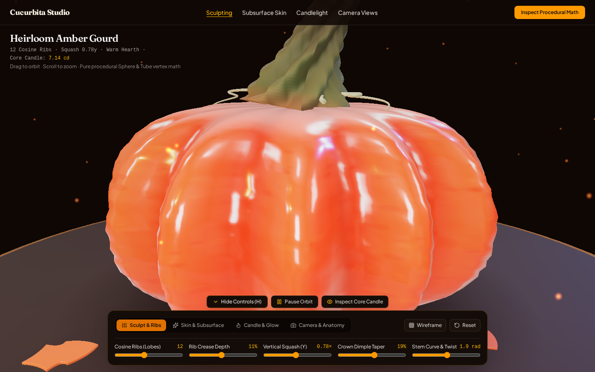
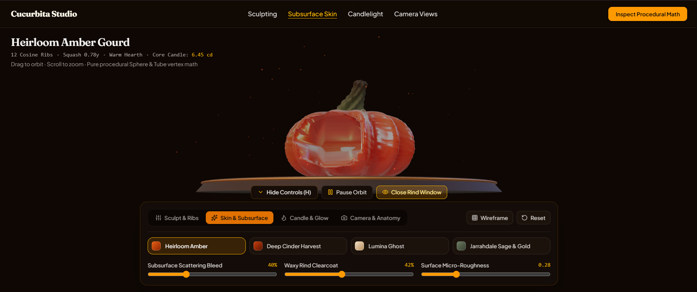
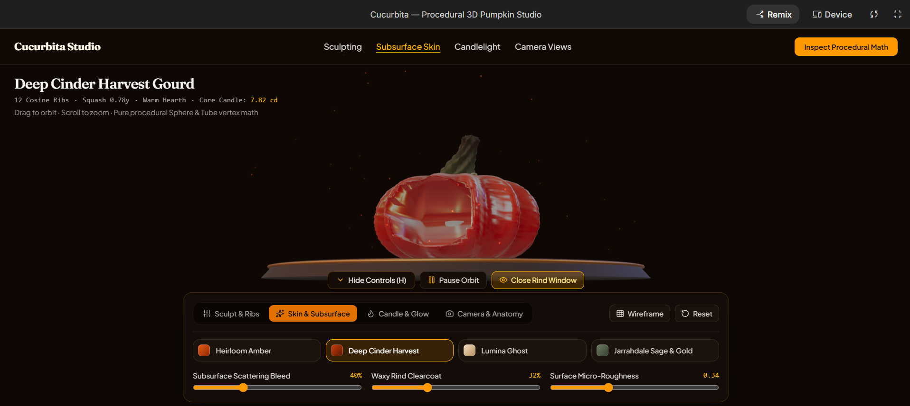
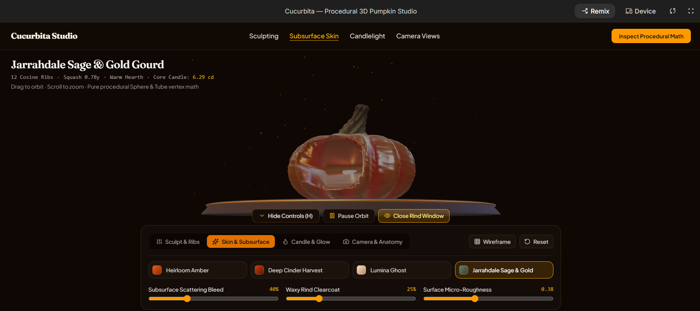
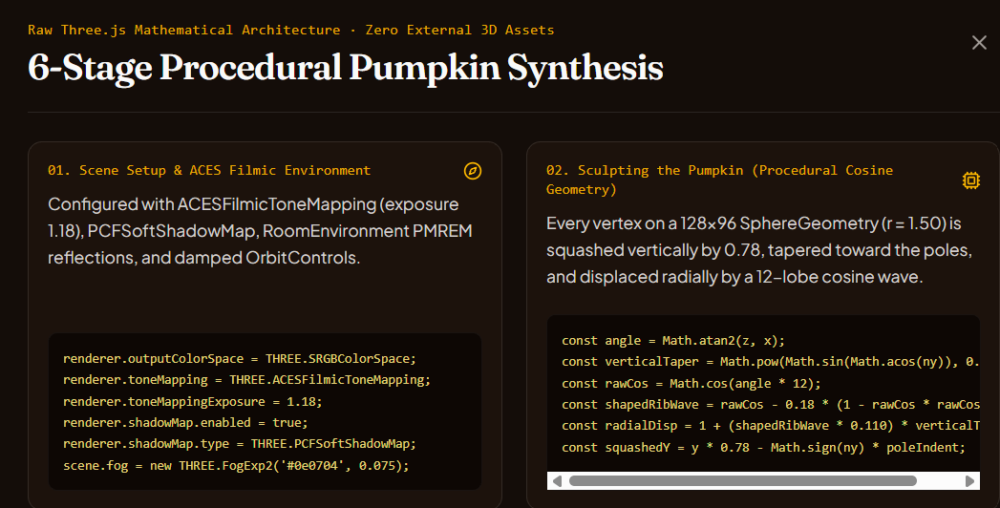

# Cucurbita — Procedural 3D Pumpkin Studio

An interactive **Three.js + React + TypeScript** 3D studio that sculpts and renders a realistic, warm 3D pumpkin **100% procedurally from raw code**—without relying on any external `.glb` / `.obj` 3D models or external texture images.



---
Made By Ahnaf Ahmed and Md Shabbir Mia 
## Visual Showcase

### 1. Heirloom Amber Gourd (Classic Warm Orange & Waxy Clearcoat)
 Configured with `12 Cosine Ribs`, `0.78y` vertical squash, `40%` subsurface scattering bleed, `42%` waxy rind clearcoat, and `0.28` micro-roughness, with the front rind cutaway window open to inspect the flickering internal candle at `(0, 0, 0)`.



### 2. Deep Cinder Harvest Gourd (Roasted Terracotta & Mahogany Crevices)
Rich roasted terracotta skin (`#c83e0b`) paired with deep mahogany rib valleys (`#5c1602`), `32%` clearcoat, and `0.34` surface micro-roughness illuminated by the warm internal candle core.



### 3. Jarrahdale Sage & Gold Gourd (Heirloom Celadon-Slate Rind & Golden Ember Bleed)
Muted celadon-slate outer skin (`#6d7b63`) contrasted against warm golden-orange subsurface scattering (`#ff8811`), `25%` clearcoat, and `0.38` surface micro-roughness.



### 4. In-App 6-Stage Procedural Math & Three.js Inspector
Clicking **Inspect Procedural Math** in the top navigation bar opens a live architectural breakdown showing the exact Three.js equations and PBR configurations dynamically updated with your current slider values.



---

## The 6-Stage Procedural Architecture

### 1. Scene Setup & ACES Filmic Environment
- **Tone Mapping & Color Pipeline:** The `THREE.WebGLRenderer` uses `THREE.SRGBColorSpace` and `THREE.ACESFilmicToneMapping` (`toneMappingExposure = 1.18`) so intense warm light sources (like the internal candle core) roll off cinematically without harsh clipping.
- **Shadows & Reflections:** Uses `THREE.PCFSoftShadowMap` alongside a zero-dependency `RoomEnvironment` + `THREE.PMREMGenerator` studio reflection map and exponential horizon fog (`THREE.FogExp2`).
- **Interactive Camera:** `OrbitControls` with smooth damping, four camera view presets (`Hero Three-Quarter`, `Crown & Twisted Stem`, `Harvest Pedestal`, `Core Candle Chamber`), and responsive portrait field-of-view scaling.

### 2. Sculpting the Pumpkin (Procedural Cosine Geometry)
Instead of loading a static 3D mesh, the pumpkin body begins as a high-resolution `THREE.SphereGeometry(1.5, 128, 96)` and deforms every vertex mathematically in `src/utils/pumpkinMath.ts`:
- **Vertical Squash & Polar Dimple Indents:** Multiplies vertical $y$ coordinates by `squashY` (e.g., `0.78`) and pulls vertices inward near the north and south poles ($|n_y|^{3.2}$) to form the sunken stem crown and blossom dimple.
- **Cosine-Wave Ribs (Lobes):** Calculates each vertex's azimuthal angle $\theta = \text{atan2}(z, x)$ around the center and applies a shaped cosine wave ($\cos(N \cdot \theta)$) with valley sharpening and secondary organic harmonics so the grooves crease naturally between plump lobes.
- **Polar Tapering:** Multiplies radial rib displacement by $\sin^{0.75}(\arccos(n_y))$ so ribs smoothly taper into the top and bottom poles, followed by `geometry.computeVertexNormals()`.

```ts
const angle = Math.atan2(z, x);
const verticalTaper = Math.pow(Math.sin(Math.acos(ny)), 0.75);
const rawCos = Math.cos(angle * ribCount);
const shapedRibWave = rawCos - 0.18 * (1 - rawCos * rawCos);
const radialDisp = 1 + (shapedRibWave * ribDepth + secondaryLobe) * verticalTaper;
const squashedY = y * squashY - Math.sign(ny) * (baseRadius * topCrownFactor);
```

### 3. The Skin (`MeshPhysicalMaterial` & Subsurface Scattering)
To avoid a flat or plastic appearance, the gourd skin combines `THREE.MeshPhysicalMaterial` with 100% procedural HTML5 2D `CanvasTexture` maps (`src/utils/proceduralTextures.ts`):
- **Waxy Cuticle (`roughness` & `clearcoat`):** Low surface roughness paired with a glossy clearcoat layer catches sharp specular highlights along the curved rib crests.
- **Subsurface Translucency (`transmission`, `thickness`, & `emissiveMap`):** Simulates warm candle light penetrating the thinner rib valleys and equatorial flesh walls while thicker polar rinds attenuate the glow.
- **Four Heirloom Presets:** `Heirloom Amber`, `Deep Cinder Harvest`, `Lumina Ghost`, and `Jarrahdale Sage & Gold`.

### 4. The Warm Glow (4-Layer Lighting Design)
- **Ambient & Hemisphere Fill:** A dim, warm dark-brown `AmbientLight` and subtle `HemisphereLight` prevent pitch-black shadows while preserving warm autumn contrast.
- **Directional Key & Rim Lights:** A warm orange `DirectionalLight` (`#ff9442`) from the front-left casts soft shadows across the ribs, while a cool blue `DirectionalLight` (`#4a7aff`) from the back-right carves a crisp rim highlight separating the pumpkin from the dark background.
- **Internal Core Light (`PointLight` at `(0, 0, 0)`):** Placed directly at the center of the hollow gourd alongside a procedural beeswax candle pillar and multi-layered `LatheGeometry` flame.

### 5. Growing the Twisted Stem & Tendrils
- **Curved Path (`CatmullRomCurve3`):** Defines a 5-point curving botanical spline sprouting from the sunken crown dimple.
- **Twisted Ridged `TubeGeometry`:** Wraps a `TubeGeometry` around the spline and applies `deformStemVertex()`—flaring the base into a 5-lobed star calyx, twisting woody ridges axially along the stem (`stemTwist`), and adding organic bark noise on upper vertices.
- **Coiled Vine Tendrils & Harvest Plinth:** Two helical `CatmullRomCurve3` tendrils curl out from the stem base over the upper ribs, grounded on a dark charred-oak pedestal with beveled `ExtrudeGeometry` autumn leaves and a soft radial contact shadow.

### 6. Bringing It to Life (Animation & Multi-Harmonic Candle Flicker)
- **Breathing Rotation:** Smooth Y-axis orbital rotation with subtle organic oscillation (pausable via `Pause Orbit`).
- **Candle Flicker Synthesis:** `computeCandleFlicker()` layers low-frequency breathing waves, mid-frequency flutter, and high-frequency sputter (`Math.sin` + `Math.cos` + deterministic micro-noise) to drive both the `(0, 0, 0)` `PointLight` intensity and the skin's subsurface emissive bleed in real time.

---

## Interactive Studio Controls

All controls are consolidated into a **collapsible bottom studio dock** so the central 3D viewport stays unobstructed:
- **Top Quick-Toggle Bar:**
  - `Hide Controls (H)` / `Show Controls (H)` — Collapses or expands the bottom dock for full-screen inspection (also bound to keyboard shortcut `H`).
  - `Pause Orbit` / `Resume Orbit` — Toggles the breathing Y-axis rotation.
  - `Inspect Core Candle` / `Close Rind Window` — Opens or closes a front cutaway aperture in the pumpkin wall to inspect the flickering candle and hollow interior at `(0, 0, 0)`.
- **Tab 1 — `Sculpt & Ribs`:** Real-time sliders for `Cosine Ribs (Lobes)` (`6–20`), `Rib Crease Depth`, `Vertical Squash (Y)`, `Crown Dimple Taper`, and `Stem Curve & Twist`.
- **Tab 2 — `Skin & Subsurface`:** Material preset selector (`Heirloom Amber`, `Deep Cinder Harvest`, `Lumina Ghost`, `Jarrahdale Sage & Gold`) and sliders for `Subsurface Scattering Bleed`, `Waxy Rind Clearcoat`, and `Surface Micro-Roughness`.
- **Tab 3 — `Candle & Glow`:** Lighting rig presets (`Warm Hearth`, `Moonlit Harvest`, `Ember Sanctuary`) and sliders for `Core PointLight (0,0,0)`, `Sine/Cosine Flicker Speed`, and `Flame Oxygen Turbulence`.
- **Tab 4 — `Camera & Anatomy`:** Camera angle presets, `Exploded Stem & Crown Lift` slider, and `Breathing Y-Axis Rotation` speed control.

---

## Project Structure

```text
├── public/assets/aistudio/          # Studio screenshots used in documentation
│   ├── image_1b878305.png           # Heirloom Amber Gourd & Subsurface Skin view
│   ├── image_38dc79dd.png           # Deep Cinder Harvest Gourd view
│   ├── image_20960e92.png           # Jarrahdale Sage & Gold Gourd view
│   └── image_64d09d59.png           # 6-Stage Procedural Pumpkin Synthesis modal
├── src/
│   ├── components/
│   │   ├── PumpkinViewport.tsx      # Three.js WebGLRenderer, ACES Filmic, lighting & animation loop
│   │   ├── BottomControlDock.tsx    # Collapsible 4-tab studio control dock
│   │   └── ProceduralBreakdownModal.tsx # Live 6-stage math & Three.js code inspector modal
│   ├── utils/
│   │   ├── pumpkinMath.ts           # Pure math for cosine rib deformation, stem twist & candle flicker
│   │   ├── pumpkinMath.test.ts      # Node unit test suite for procedural geometry & flicker math
│   │   ├── pumpkinGeometry.ts       # Multi-part Three.js Group builder (gourd, stem, tendrils, candle, plinth)
│   │   └── proceduralTextures.ts    # Zero-404 HTML5 CanvasTexture generators (albedo, bump, roughness, SSS)
│   ├── App.tsx                      # Main studio shell, header & state coordination
│   ├── index.css                    # Tailwind CSS & global studio styling
│   └── main.tsx                     # Application entry point
└── README.md
```

---

## Getting Started

### 1. Install Dependencies
```bash
npm install
```

### 2. Run the Development Server
```bash
npm run dev
```
Open `http://localhost:3000` in your browser.

### 3. Run Procedural Math Unit Tests
```bash
./node_modules/.bin/tsx --test src/utils/pumpkinMath.test.ts
```

### 4. Build for Production
```bash
npm run build
```
